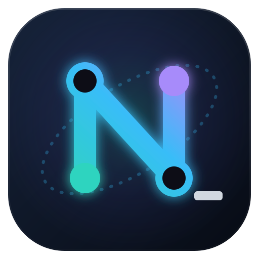
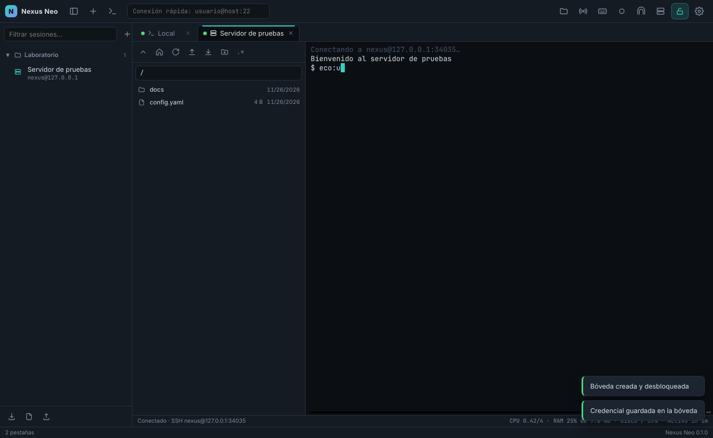
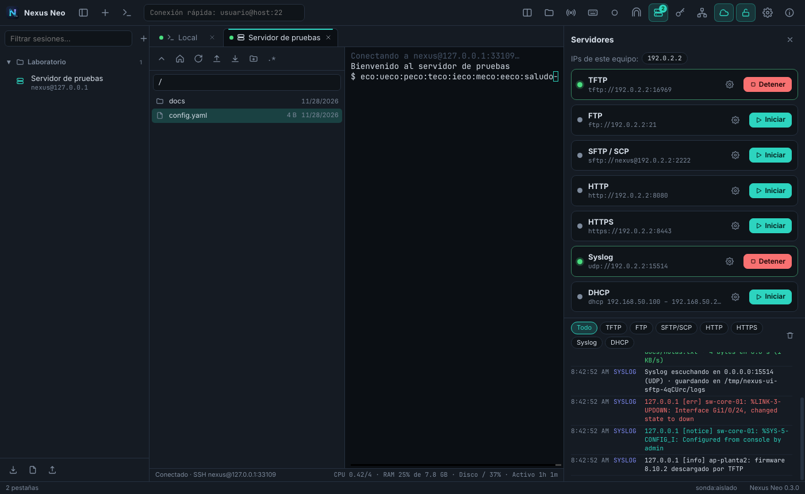
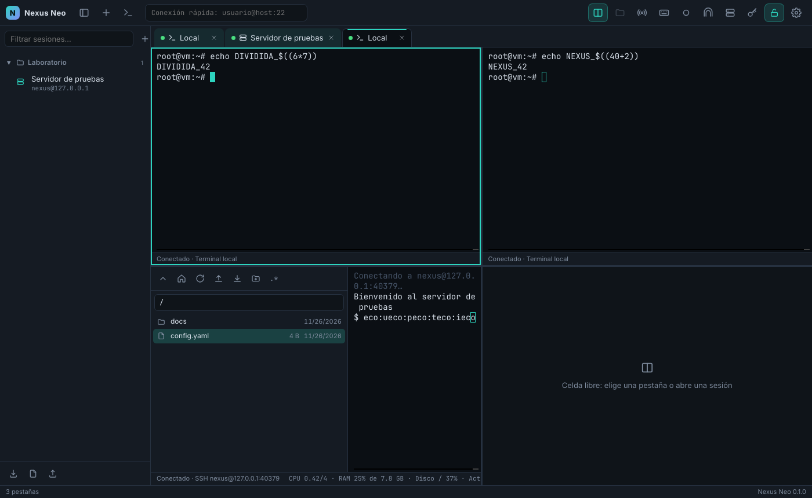
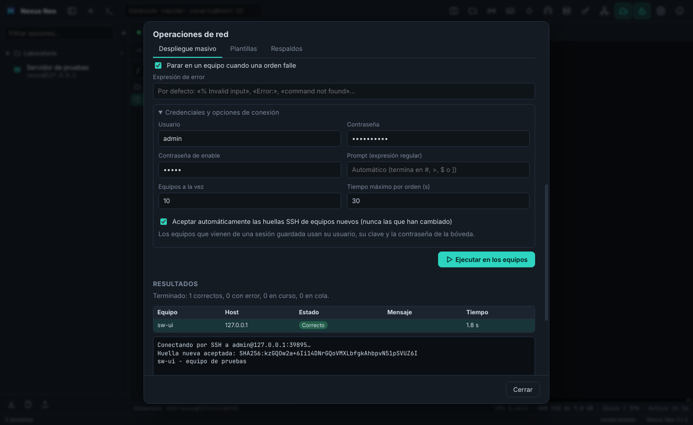
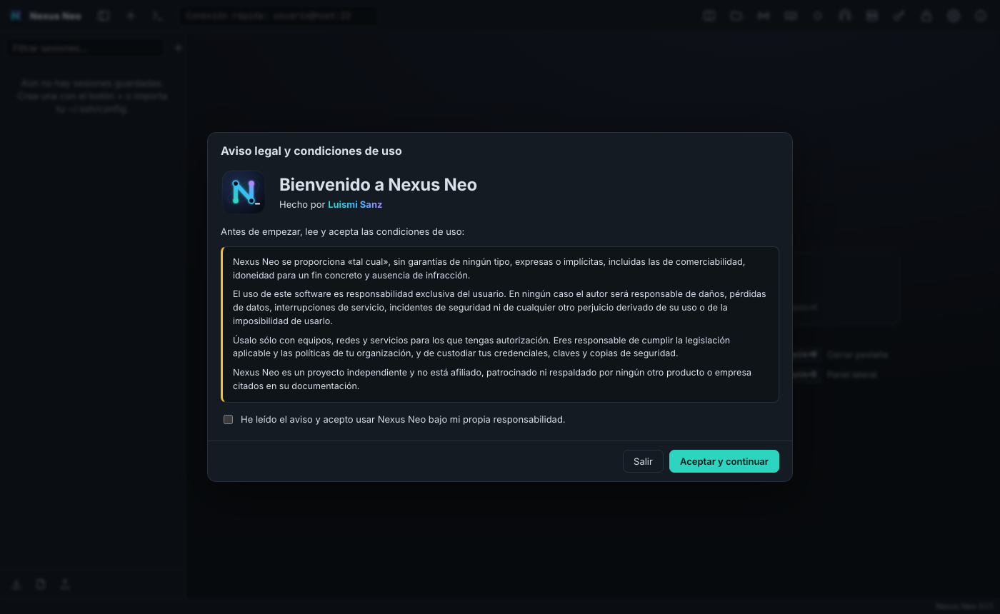

<p align="center"></p>

# Nexus Neo

**Hecho por Luismi Sanz.**

Cliente de acceso remoto **multiplataforma (Windows y Linux)** que reúne en una sola ventana con pestañas
SSH, SFTP, Telnet, Mosh, puerto serie, escritorio remoto RDP y VNC integrados, túneles SSH, reenvío X11,
terminal local, multi-ejecución, macros, herramientas para equipos de red (despliegue masivo, plantillas y
respaldos de configuración), sincronización cifrada entre equipos, temas, plugins y una bóveda de credenciales
cifrada. Es un proyecto original (nombre, diseño y código propios), pensado como
alternativa moderna y abierta a las «navajas suizas» de terminal para administradores de sistemas.









📖 **[Manual de usuario completo](docs/manual.md)** · 🧩 **[Cómo escribir un plugin](docs/plugins.md)**

## Funcionalidades

### Disponibles en la versión 0.3.0

| Área | Qué incluye |
| --- | --- |
| **Sesiones en pestañas** | Pestañas ilimitadas, reordenables, renombrables, con color por sesión, estado de conexión, duplicar, reconectar (tecla `R` tras desconexión) y guardar la salida en un archivo. |
| **Gestor de sesiones** | Árbol por carpetas, filtro instantáneo, editar/duplicar/eliminar, exportar e importar (formato JSON propio, sin contraseñas) e **importación de `~/.ssh/config`** (incluye `ProxyJump`, `ForwardX11` y reenvíos). |
| **SSH** | Contraseña, clave privada (con frase de paso), agente SSH (OpenSSH/Pageant en Windows), keyboard-interactive/2FA, keepalive, `TERM` configurable, verificación de huella del host (TOFU) con **aviso de posible ataque MITM** si la clave cambia. |
| **Bastiones (ProxyJump)** | Saltos encadenados a través de otras sesiones guardadas. |
| **Explorador SFTP** | Panel lateral redimensionable junto al terminal: navegar, subir/descargar (también carpetas completas y arrastrar y soltar desde el escritorio), barra de progreso, crear carpetas, renombrar, borrar, `chmod`, copiar ruta y **editar archivos remotos en el momento**. |
| **Túneles SSH** | Local (`-L`), remoto (`-R`) y dinámico SOCKS5 (`-D`). Se definen por sesión con arranque automático o se crean al vuelo; gestor con estado y nº de conexiones activas. |
| **Reenvío X11** | Reenvía aplicaciones gráficas al servidor X local (Linux de forma nativa usando la cookie de `xauth`; en Windows con un servidor X como VcXsrv o X410). |
| **Terminal local** | Detección automática de shells: PowerShell 7, Windows PowerShell, CMD, WSL y Git Bash en Windows; los de `/etc/shells` en Linux. |
| **Telnet** | Con negociación de eco, SGA, tamaño de ventana (NAWS) y tipo de terminal. |
| **Puerto serie** | Lista de puertos detectados, baudios, bits de datos/parada, paridad y eco local. |
| **Visor VNC integrado** | Ventana propia basada en noVNC: conexión directa o **a través de un túnel SSH** de una sesión guardada, escalado, sólo lectura, `Ctrl+Alt+Supr`, envío del portapapeles, pantalla completa y contraseña guardada en la bóveda. Opcionalmente se puede usar un visor externo. |
| **Visor RDP integrado** | Ventana propia sin depender de `mstsc` ni FreeRDP: NLA/CredSSP y TLS con verificación del certificado, resolución dinámica, ajustar a la ventana, `Ctrl+Alt+Supr`, tecla Windows, portapapeles de texto, pantalla completa, reconexión, contraseña en la bóveda y **túnel SSH** opcional. Sigue siendo posible usar el cliente del sistema. |
| **Mosh** | Cliente Mosh integrado (no hace falta instalar nada en tu equipo): entra por SSH, arranca `mosh-server` y sigue por UDP cifrado. La sesión sobrevive a cambios de red, suspensiones y cortes. Puertos, orden remota, locale y dirección UDP configurables. |
| **Despliegue masivo** | Ejecuta órdenes con variables (`{{host}}`, columnas de un CSV…) y directivas (`!espera`, `!intro`, `!timeout`) en muchos switches y routers a la vez por SSH o Telnet, con modo enable, paginadores, preguntas de confirmación, detección de errores y **subida previa de firmware por SCP o SFTP**. Resultado y registro por equipo, `resumen.csv` y `resumen.json`. |
| **Plantillas de configuración** | Configuraciones con variables rellenadas por equipo desde un CSV, con vista previa, generación de archivos `.cfg` y aplicación directa con el despliegue. |
| **Respaldos de configuración** | 13 perfiles de fabricante (Cisco IOS/NX-OS/ASA, Aruba, HPE, Huawei, Juniper, MikroTik, FortiGate, Palo Alto, Dell…). Sólo guarda una versión nueva si la configuración cambia (ignora líneas volátiles), historial por equipo, **comparación entre versiones** y respaldo programado. |
| **Sincronización cifrada** | Sesiones, macros, plantillas y temas entre tus equipos a través de una carpeta compartida (Dropbox, OneDrive, Syncthing, NAS…) o SFTP, en un único archivo cifrado con tu frase (scrypt + AES-256-GCM). Contraseñas de la bóveda opcionales. |
| **Temas personalizables** | Editor con vista previa en vivo y aviso de contraste; importa esquemas de **Windows Terminal** e **iTerm2**; exporta a JSON. |
| **Plugins** | Comandos para la paleta, reacciones a la salida del terminal, barra de estado y temas. Cada plugin corre aislado en un Web Worker (sin Node, red ni DOM) y con permisos que aceptas al activarlo. |
| **Vista dividida** | Una, dos (en columnas o filas) o cuatro sesiones a la vez en la misma ventana (`Ctrl+Mayús+D` cambia la disposición); clic en un panel para enfocarlo. |
| **Registro de sesiones** | Guarda automáticamente la salida de todas las sesiones o sólo de las marcadas, en una carpeta por día, con opción de quitar los códigos de color. |
| **Claves SSH** | Generador de claves ed25519, RSA y ECDSA (con frase de paso opcional), lista de claves de `~/.ssh` con huella SHA256 e **instalación de la clave pública en `authorized_keys`** de un servidor con un clic. **Importación de claves** (por ejemplo las que descargas de Oracle Cloud o AWS) a `~/.ssh` y **corrección automática de permisos**: en Windows ajusta la ACL para que sólo tu usuario pueda leer la clave, así `ssh -i`, scp o git no la rechazan con «UNPROTECTED PRIVATE KEY FILE». |
| **Reconexión automática** | Si una sesión SSH o Telnet se cae, reintenta sola hasta 5 veces con espera creciente; también manualmente con `R`. |
| **Servidores integrados** | Panel lateral (`Ctrl+Mayús+E`) con **TFTP** (blksize/tsize, subida y bajada), **FTP** (pasivo/activo, usuario o anónimo), **SFTP/SCP** (servidor SSH sólo de archivos, contraseña o claves, SCP clásico y moderno), **HTTP** (listados, descargas reanudables, PUT opcional), **HTTPS** (certificado propio o autofirmado automático), **Syslog** (UDP/TCP, colores por severidad y archivo diario) y **DHCP** (rango, reservas por MAC, puerta de enlace, DNS y opciones 66/67/150 para teléfonos IP, PXE y ZTP, con tabla de concesiones). Arranque con un clic, carpeta raíz, puerto e interfaz configurables, IPs del equipo a mano y registro de transferencias en vivo. Ideal para actualizar firmware y guardar configuraciones de switches, routers y AP. |
| **Multi-ejecución** | Escribe a la vez en todas las pestañas marcadas (casilla en cada pestaña). |
| **Macros** | Editor de macros con escapes (`\n`, `\t`, `\e`, `\xHH`) y pausas `{sleep:ms}`, **grabación** de lo que tecleas, ejecución en una pestaña o en todas las de multi-ejecución, y macro de arranque por sesión. |
| **Bóveda de credenciales** | Contraseña maestra, scrypt + AES-256-GCM, bloqueo manual y automático por inactividad, cambio de contraseña maestra. Los secretos nunca se guardan en claro. |
| **Monitor remoto** | Barra inferior con carga de CPU, RAM, disco y tiempo encendido del servidor SSH activo. |
| **Personalización** | 5 temas integrados más los tuyos, tipografía, tamaño (zoom con `Ctrl` `+`/`-`), cursor, historial, copiar al seleccionar, pegar con clic derecho. |
| **Productividad** | Conexión rápida (`usuario@host:puerto`, `telnet://`, `mosh://`, `rdp://`, `vnc://`), paleta de comandos `Ctrl+Mayús+K`, búsqueda en el terminal, enlaces clicables. |
| **Modo portable** | Crea un archivo llamado `portable` junto al ejecutable y los datos se guardan en `./data`. |

### Mejoras frente a las herramientas clásicas

- **Nativo en Linux**, no sólo Windows.
- Importación directa de `~/.ssh/config`, incluidos bastiones y túneles.
- Edición de archivos remotos desde el panel SFTP sin herramientas externas.
- Grabación de macros y pausas temporizadas.
- Visor VNC que puede ir por un túnel SSH sin configurar reenvíos a mano.
- Instalación de claves públicas en servidores desde la propia app.
- Paleta de comandos y conexión rápida tipo URI.
- Advertencia explícita ante cambios de clave de host.
- Bóveda con cifrado autenticado (detecta manipulaciones del archivo) y autobloqueo.
- Código abierto, auditable y extensible.

## Hoja de ruta

Hecho desde el MVP: servidores integrados, vista dividida, registro de sesiones, claves SSH, reconexión
automática, visores VNC y RDP integrados, Mosh, sincronización cifrada, despliegue masivo, plantillas y
respaldos de configuración, temas personalizables y plugins.

Próximas funciones:

- [ ] Desacoplar pestañas en ventanas propias y reproducción de los registros de sesión.
- [ ] **Servidor X11 integrado en Windows** (empaquetar VcXsrv/Xming opcional) para no depender de software externo.
- [ ] **rlogin, FTP/FTPS, XDMCP** y sesiones de explorador de archivos (S3, WebDAV).
- [ ] Ampliar la API de plugins (nuevos protocolos y paneles).
- [ ] SFTP que **sigue la carpeta del terminal**, cola de transferencias en paralelo y reanudación.
- [ ] **Herramientas de red**: escáner de puertos y ping/traceroute gráficos.
- [ ] **Importación de sesiones** desde otras herramientas (archivos de exportación de clientes populares, PuTTY desde el registro de Windows).
- [ ] Integración con el almacén de credenciales del sistema (Windows Credential Manager / libsecret) y llaves FIDO2.
- [ ] Personalizador de marca para despliegues corporativos (logo, ajustes predefinidos).
- [ ] Firmado de código y actualizaciones automáticas.
- [ ] Traducción al inglés (i18n).

## Instalación y desarrollo

Requisitos: Node.js 20 o superior.

```bash
npm install
npm run dev          # compila y abre la app
npm test             # pruebas unitarias e integración (SSH/SFTP/túneles, Mosh, RDP, sincronización y switches simulados)
npm run test:ui      # prueba de humo de la interfaz con Playwright (en Linux sin pantalla: xvfb-run -a npm run test:ui)
npm run typecheck
```

Paquetes instalables:

```bash
npm run dist:linux   # AppImage y .deb en release/
npm run dist:win     # instalador NSIS y versión portable (ejecutar en Windows)
```

Icono: el original está en `build/icon.svg` (y `build/icon-small.svg`, una variante simplificada para 16–32 px).
Tras modificarlo, `npm run icons` regenera `build/icon.png`, `build/icons/*.png` (Linux) y `build/icon.ico` (Windows).

Los módulos nativos (`node-pty`, `serialport`) usan N-API, así que no hace falta recompilarlos para Electron.
El flujo de GitHub Actions compila y prueba en Linux y Windows y publica los paquetes como artefactos.

## Atajos de teclado

| Atajo | Acción |
| --- | --- |
| `Ctrl+Mayús+T` | Nueva terminal local |
| `Ctrl+Mayús+W` | Cerrar pestaña |
| `Ctrl+Tab` / `Ctrl+Mayús+Tab` | Pestaña siguiente / anterior |
| `Ctrl+Mayús+K` | Paleta de comandos e ir a sesión |
| `Ctrl+Mayús+E` | Panel de servidores (TFTP, FTP, HTTP, Syslog) |
| `Ctrl+Mayús+D` | Cambiar la vista dividida (1, 2 o 4 paneles) |
| `Ctrl+Mayús+M` | Activar/desactivar multi-ejecución |
| `Ctrl+Mayús+S` | Mostrar/ocultar SFTP |
| `Ctrl+Mayús+B` | Mostrar/ocultar el panel de sesiones |
| `Ctrl+Mayús+F` | Buscar en el terminal |
| `Ctrl+Mayús+C` / `Ctrl+Mayús+V` | Copiar / pegar |
| `Ctrl` `+` / `-` / `0` | Zoom del texto |

## Arquitectura

```
src/
  main/            Proceso principal de Electron (Node.js)
    protocols/     ssh (ssh2), local (node-pty), telnet, serial (serialport), mosh (cliente SSP propio), túneles, SOCKS5, clientes externos
    rdp/           Pasarela RDCleanPath local (TCP/TLS o túnel SSH) para el visor RDP
    netops/        Sesiones de CLI desatendidas, SCP, despliegue masivo y respaldos
    vault.ts       Bóveda cifrada (scrypt + AES-256-GCM)
    store.ts       Sesiones, macros, plantillas, temas, ajustes y huellas conocidas (JSON)
    sync*.ts       Sincronización cifrada entre equipos (carpeta o SFTP)
    plugins.ts     Instalación, manifiestos y almacenamiento de plugins
    sftp-ops.ts    Operaciones SFTP de alto nivel
    importers.ts   Importación de ~/.ssh/config y exportaciones propias
    servers/       Servidores integrados TFTP, FTP, SFTP/SCP, HTTP/HTTPS, Syslog y DHCP
    keys.ts        Generación de claves e instalación en authorized_keys
    session-log.ts Registro de sesiones a archivo
    vnc-bridge.ts  Puente TCP/SSH para el visor VNC
  preload/         Puente IPC mínimo (contextIsolation + sandbox)
  renderer/        Interfaz (TypeScript sin framework + xterm.js; VNC con noVNC; RDP con IronRDP en WebAssembly; plugins en Web Workers)
  shared/          Tipos, plantillas, CSV, diferencias y formatos de tema compartidos
examples/plugins/  Plugin de ejemplo
docs/              Manual de usuario y guía de plugins
test/              Pruebas (node:test), servidor SSH/SFTP de pruebas y switch simulado
```

Seguridad: la interfaz se ejecuta con `contextIsolation`, `sandbox` y sin `nodeIntegration`, con CSP estricta.
Las contraseñas sólo viajan al proceso principal y sólo se escriben en disco cifradas en la bóveda.

## Autoría

Nexus Neo está hecho por **Luismi Sanz**. La ventana «Acerca de» (botón ⓘ de la barra superior o «Acerca de»
en la paleta `Ctrl+Mayús+K`) muestra la versión, la autoría y el aviso legal.

## Aviso legal



Nexus Neo se proporciona **«tal cual»**, sin garantías de ningún tipo, expresas o implícitas, incluidas las de
comerciabilidad, idoneidad para un fin concreto y ausencia de infracción.

**El uso de este software es responsabilidad exclusiva del usuario.** En ningún caso el autor será responsable
de daños, pérdidas de datos, interrupciones de servicio, incidentes de seguridad ni de cualquier otro perjuicio
derivado de su uso o de la imposibilidad de usarlo.

Úsalo sólo con equipos, redes y servicios para los que tengas autorización. Eres responsable de cumplir la
legislación aplicable y las políticas de tu organización, y de custodiar tus credenciales, claves y copias de
seguridad.

Nexus Neo es un proyecto independiente y no está afiliado, patrocinado ni respaldado por ningún otro producto o
empresa citados en su documentación.

La primera vez que se abre la aplicación hay que aceptar este aviso (si no, se cierra), y el instalador de
Windows lo muestra junto a la licencia antes de instalar. El texto vive en `src/shared/legal.ts`; si cambia
`DISCLAIMER_VERSION`, se vuelve a pedir la aceptación.

## Licencia

MIT © 2026 Luismi Sanz. Consulta [LICENSE](LICENSE).
