# Manual de usuario de Nexus Neo

Versión 0.3.0 · Hecho por Luismi Sanz

Nexus Neo es un cliente de acceso remoto para **Windows y Linux** que reúne en una sola ventana con pestañas
SSH, SFTP, Telnet, Mosh, puerto serie, escritorio remoto (RDP y VNC), túneles SSH, servidores de
transferencia, herramientas para equipos de red y una bóveda de credenciales cifrada.

Este manual explica cómo instalarlo y cómo usar cada función. Si buscas cómo escribir un plugin, consulta
[plugins.md](plugins.md).

## Índice

1. [Instalación](#1-instalación)
2. [Primer arranque](#2-primer-arranque)
3. [La ventana principal](#3-la-ventana-principal)
4. [Sesiones](#4-sesiones)
5. [SSH](#5-ssh)
6. [Explorador SFTP](#6-explorador-sftp)
7. [Túneles SSH y reenvío X11](#7-túneles-ssh-y-reenvío-x11)
8. [Mosh](#8-mosh)
9. [Telnet, puerto serie y terminal local](#9-telnet-puerto-serie-y-terminal-local)
10. [Escritorio remoto: RDP y VNC](#10-escritorio-remoto-rdp-y-vnc)
11. [Vista dividida, multi-ejecución y macros](#11-vista-dividida-multi-ejecución-y-macros)
12. [Bóveda de credenciales](#12-bóveda-de-credenciales)
13. [Claves SSH](#13-claves-ssh)
14. [Servidores integrados: TFTP, FTP, SFTP/SCP, HTTP, HTTPS, Syslog y DHCP](#14-servidores-integrados-tftp-ftp-sftpscp-http-https-syslog-y-dhcp)
15. [Operaciones de red: despliegue masivo, plantillas y respaldos](#15-operaciones-de-red)
16. [Sincronización cifrada entre equipos](#16-sincronización-cifrada-entre-equipos)
17. [Temas](#17-temas)
18. [Plugins](#18-plugins)
19. [Ajustes y registro de sesiones](#19-ajustes-y-registro-de-sesiones)
20. [Atajos de teclado](#20-atajos-de-teclado)
21. [Dónde se guardan los datos y modo portable](#21-dónde-se-guardan-los-datos-y-modo-portable)
22. [Seguridad](#22-seguridad)
23. [Solución de problemas](#23-solución-de-problemas)

---

## 1. Instalación

### Windows

Descarga de la página de *Releases* del repositorio una de estas dos opciones:

- **Instalador** (`Nexus Neo Setup x.y.z.exe`): te deja elegir la carpeta de instalación y crea accesos
  directos. Antes de instalar muestra la licencia y el aviso legal.
- **Portable** (`Nexus Neo x.y.z.exe`): no se instala; se ejecuta desde cualquier carpeta o un USB.
  Lee también el [modo portable](#21-dónde-se-guardan-los-datos-y-modo-portable).

Requisitos: Windows 10 o 11 de 64 bits. Para el reenvío X11 necesitas un servidor X para Windows (VcXsrv,
X410…). El resto no depende de nada externo.

### Linux

- **AppImage**: dale permiso de ejecución (`chmod +x "Nexus Neo-"*.AppImage`) y ábrelo.
- **.deb** (Debian, Ubuntu y derivadas): `sudo apt install ./nexus-neo_x.y.z_amd64.deb`.

### Desde el código fuente

Necesitas Node.js 20 o superior.

```bash
npm install
npm run dev          # compila y abre la aplicación
npm run dist:linux   # genera AppImage y .deb en release/
npm run dist:win     # genera instalador y portable (ejecutar en Windows)
```

## 2. Primer arranque

La primera vez aparece el **aviso legal**: el programa se proporciona tal cual y su uso es responsabilidad
tuya. Marca la casilla y pulsa **Aceptar y continuar** (si eliges **Salir**, la aplicación se cierra y te lo
volverá a preguntar).

Después verás la pantalla de bienvenida con accesos a **Nueva sesión**, **Terminal local** e **Importar
~/.ssh/config**.

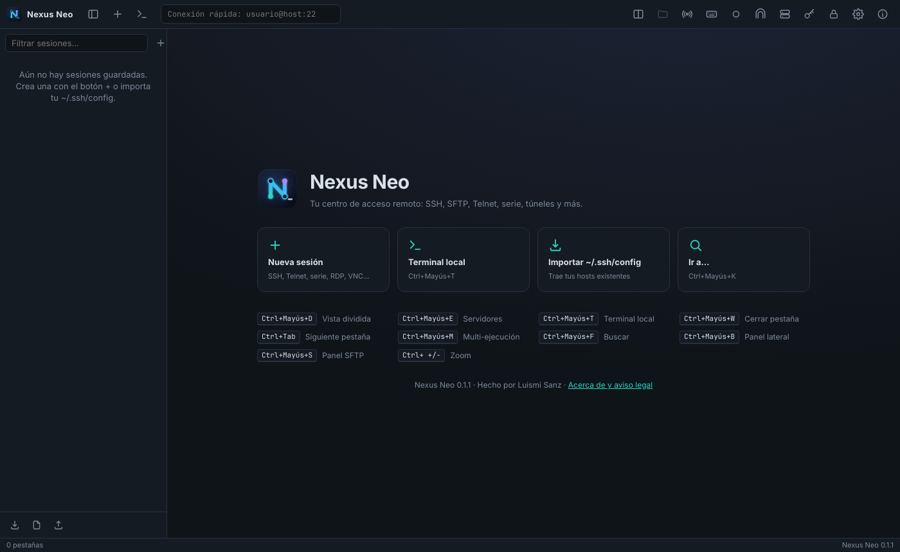

Recomendación: antes de guardar contraseñas, crea la **bóveda** (botón del candado en la barra superior). Ver
[Bóveda de credenciales](#12-bóveda-de-credenciales).

## 3. La ventana principal

- **Barra superior**: panel de sesiones, nueva sesión, terminal local, **conexión rápida** (escribe
  `usuario@host:puerto`, `telnet://host`, `mosh://usuario@host`, `rdp://host` o `vnc://host` y pulsa Intro),
  vista dividida, SFTP, multi-ejecución, macros, grabar macro, túneles, servidores integrados, claves SSH,
  **operaciones de red**, sincronización, bóveda, ajustes y «Acerca de».
- **Panel de sesiones** (izquierda): árbol de carpetas con tus sesiones guardadas y un filtro. Doble clic o
  Intro para conectar, F2 para editar, Supr para borrar, clic derecho para más opciones.
- **Pestañas**: cada conexión abre una pestaña con un punto de estado (verde conectado, ámbar conectando, rojo
  error). Se pueden reordenar, renombrar (doble clic), duplicar, reconectar y guardar su salida en un archivo.
- **Barra de estado** (abajo): número de pestañas, avisos (multi-ejecución activa, grabando macro), lo que
  muestren los plugins y, en sesiones SSH, CPU, RAM, disco y tiempo encendido del servidor.
- **Paleta de comandos** (`Ctrl+Mayús+K`): busca y abre sesiones, pestañas, macros, temas, comandos de plugins y
  cualquier acción de la aplicación.

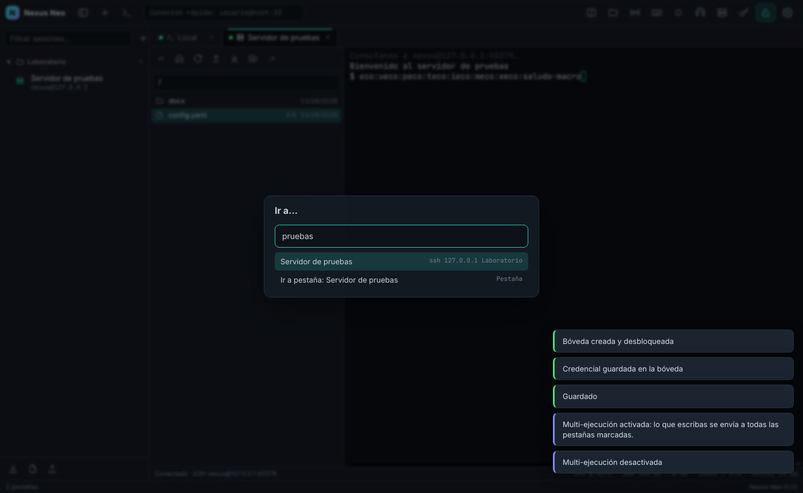

## 4. Sesiones

Pulsa **+** (Nueva sesión) y elige el tipo: SSH, Mosh, Telnet, puerto serie, terminal local, RDP o VNC.

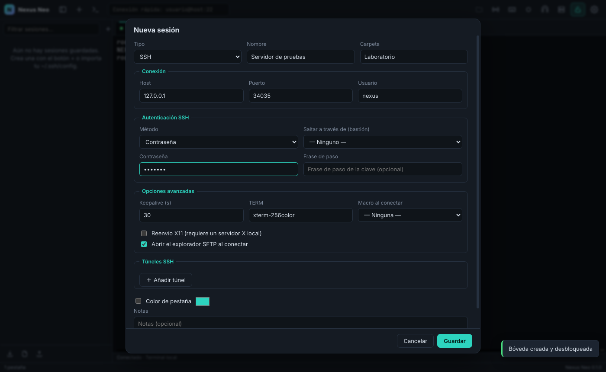

Campos comunes: nombre, carpeta (escribe `Clientes/Madrid` para crear subcarpetas), color de la pestaña,
host, puerto y usuario. Las contraseñas se guardan **sólo en la bóveda**, nunca en claro.

- **Importar `~/.ssh/config`**: crea una sesión por cada `Host` con su usuario, puerto, clave, `ProxyJump`,
  `ForwardX11` y reenvíos `LocalForward`/`RemoteForward`/`DynamicForward`.
- **Exportar / importar**: los iconos de la parte inferior del panel exportan tus sesiones a un JSON (sin
  contraseñas) e importan una exportación de Nexus Neo.
- **Duplicar** una sesión desde el menú contextual para crear otra parecida.

## 5. SSH

Métodos de autenticación:

| Método | Uso |
| --- | --- |
| Contraseña | Se pide al conectar o se toma de la bóveda. |
| Clave privada | Elige el archivo; si tiene frase de paso, se pide o se guarda en la bóveda. |
| Agente SSH | Usa el agente de OpenSSH (o Pageant en Windows). |
| Keyboard-interactive / 2FA | Las preguntas del servidor aparecen en un diálogo. |

**Huella del servidor**: la primera vez que conectas a un servidor se muestra su huella SHA256 para que la
compruebes. Si más adelante cambia, Nexus Neo muestra un aviso rojo de posible **ataque de intermediario
(MITM)** y no conecta salvo que aceptes la nueva clave expresamente.

**Bastiones (ProxyJump)**: en «Saltar a través de» elige otra sesión guardada. Se pueden encadenar varios
saltos.

**Opciones avanzadas**: intervalo de keepalive, valor de `TERM`, macro que se ejecuta al conectar, reenvío
X11 y abrir el panel SFTP automáticamente.

**Reconexión**: si la conexión se cae, Nexus Neo reintenta hasta 5 veces con espera creciente (se puede
desactivar en Ajustes). También puedes pulsar `R` en una pestaña desconectada.

## 6. Explorador SFTP

En una pestaña SSH pulsa el botón de carpeta o `Ctrl+Mayús+S` para abrir el panel SFTP junto al terminal.

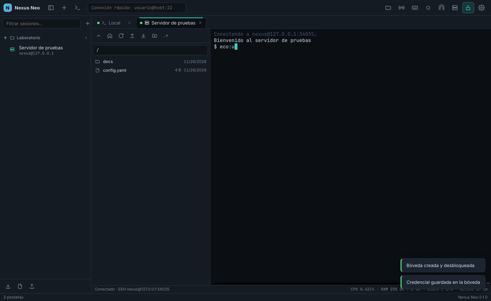

- Navega con doble clic, el botón «subir» o escribiendo la ruta.
- **Subir**: botón de subida o arrastra archivos y carpetas desde el escritorio.
- **Descargar**: selecciona y pulsa descargar; elige la carpeta de destino.
- Clic derecho: renombrar, borrar, cambiar permisos (`chmod`), copiar la ruta, crear carpeta y **editar**.
- **Editar archivos remotos**: abre el archivo en un editor y al guardar se sube de nuevo.

## 7. Túneles SSH y reenvío X11

En el editor de una sesión SSH, sección **Túneles SSH**:

- **Local (`-L`)**: un puerto de tu equipo lleva a un destino accesible desde el servidor.
- **Remoto (`-R`)**: un puerto del servidor lleva a un destino accesible desde tu equipo.
- **Dinámico (`-D`)**: un proxy SOCKS5 local que sale por el servidor.

Marca **Arranque automático** para que se abran al conectar. El botón de túneles de la barra superior muestra
los activos con su número de conexiones y permite crear túneles al vuelo.

**Reenvío X11**: viene activado en las sesiones SSH nuevas y en la conexión rápida (puedes desactivarlo en
**Opciones avanzadas**). Al conectar, el servidor define `DISPLAY` (normalmente `localhost:10.0`) y los
programas gráficos que lances allí (`xclock`, `virt-manager`…) se abren en tu escritorio.

- **Linux**: no hace falta instalar ni arrancar ningún servidor X; se usa el de tu sesión gráfica (Xorg o
  XWayland en GNOME, KDE…). Nexus Neo toma el `DISPLAY` del sistema y, si la aplicación se abrió sin él, busca
  la pantalla en `/tmp/.X11-unix`. La cookie se lee directamente de `$XAUTHORITY` o `~/.Xauthority`, así que
  no necesitas el programa `xauth` en tu equipo.
- **Windows**: abre antes un servidor X (VcXsrv o X410) en la pantalla `:0`. Con VcXsrv marca «Disable access
  control» si no usas cookie.
- **Pantalla X local**: si quieres otra pantalla (`:1`, `localhost:0.0`…) indícala en la sesión; vacío usa la
  automática.
- Como OpenSSH, al servidor se le envía una cookie falsa y Nexus Neo la cambia por la real al reenviar cada
  conexión, de modo que tu cookie X no sale del equipo.

Si `echo $DISPLAY` sale vacío en el servidor, en el terminal verás un aviso amarillo: el servidor no ha
aceptado el reenvío. Revisa `X11Forwarding yes` en `/etc/ssh/sshd_config` y que el paquete `xauth` esté
instalado **en el servidor**. Si el aviso dice que no se pudo conectar con el servidor X local, en Windows
arranca VcXsrv/X410 y en Linux comprueba que tienes sesión gráfica.

## 8. Mosh

Mosh (*mobile shell*) mantiene la sesión aunque cambies de red, suspendas el portátil o la conexión se corte un
rato, y muestra lo que escribes al instante aunque haya mucha latencia.

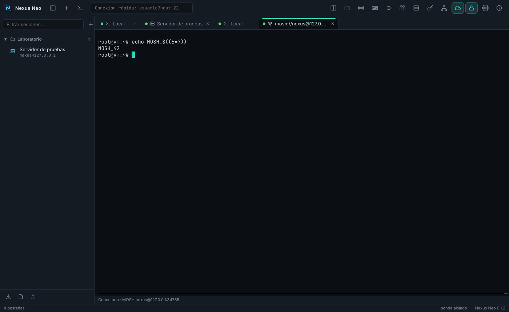

Cómo funciona: Nexus Neo entra por **SSH** con la autenticación de la sesión, arranca `mosh-server` en el
servidor y continúa por **UDP cifrado** (AES-128-OCB). No hace falta instalar nada en tu equipo: el cliente Mosh
está integrado.

Requisitos en el servidor:

- El paquete `mosh` instalado (`sudo apt install mosh`, `sudo dnf install mosh`…).
- Los puertos UDP 60000–61000 abiertos en el cortafuegos (o el rango que indiques).

Opciones de la sesión Mosh:

| Campo | Para qué sirve |
| --- | --- |
| Puertos UDP | Un puerto o rango (`60001` o `60000:60010`) si tu cortafuegos sólo abre algunos. |
| Orden remota | Lo que se ejecuta en lugar de la shell, por ejemplo `tmux new -A -s main`. |
| mosh-server | Ruta del servidor si no está en el `PATH` (p. ej. `/usr/local/bin/mosh-server`). |
| Locale | Locale UTF-8 para el servidor (por defecto `C.UTF-8`). |
| Dirección UDP | Si el UDP debe ir a otra dirección distinta de la de SSH (NAT, IP pública…). |

También puedes conectar con la conexión rápida: `mosh://usuario@servidor`.

Si la red se corta, la pestaña muestra «Sin respuesta…» y vuelve sola cuando hay conexión. Si al empezar no
llega nada por UDP en 15 segundos, revisa el cortafuegos.

## 9. Telnet, puerto serie y terminal local

- **Telnet**: para equipos antiguos o de laboratorio. Negocia eco, tamaño de ventana y tipo de terminal.
  Recuerda que Telnet no va cifrado.
- **Puerto serie**: elige el puerto de la lista detectada (COM3, `/dev/ttyUSB0`…), baudios, bits de datos,
  paridad, bits de parada y eco local. Ideal para cables de consola de switches y routers. En Linux tu usuario
  debe pertenecer al grupo `dialout`.
- **Terminal local** (`Ctrl+Mayús+T`): detecta las shells instaladas (PowerShell 7, Windows PowerShell, CMD,
  WSL y Git Bash en Windows; las de `/etc/shells` en Linux). En una sesión guardada puedes fijar la shell y la
  carpeta inicial.

## 10. Escritorio remoto: RDP y VNC

### RDP integrado

Las sesiones RDP se abren en una ventana propia de Nexus Neo, sin necesidad de `mstsc` ni FreeRDP.

- Admite **NLA/CredSSP** y TLS. La primera vez que conectas a un equipo se muestra la huella de su certificado
  para que la aceptes; si cambia, se avisa.
- Barra de herramientas: **Ajustar** a la ventana, **Resolución dinámica** (el escritorio se adapta al
  redimensionar), **Ctrl+Alt+Supr**, **tecla Windows**, **pantalla completa**, **reconectar** y **desconectar**.
- Portapapeles compartido de texto.
- Si no hay contraseña guardada, se pide al conectar con opción de **guardarla en la bóveda**.
- **Túnel SSH**: en «Túnel a través de la sesión SSH» elige una sesión SSH guardada y el escritorio remoto
  irá por ella, sin exponer el puerto 3389.
- Campos: dominio, resolución fija (por ejemplo `1920x1080`, vacío para adaptarse a la ventana) y pantalla
  completa.
- Si prefieres el cliente del sistema, marca **Abrir con el cliente RDP del sistema** en la sesión, o indica un
  cliente en Ajustes → Clientes externos.

### VNC integrado

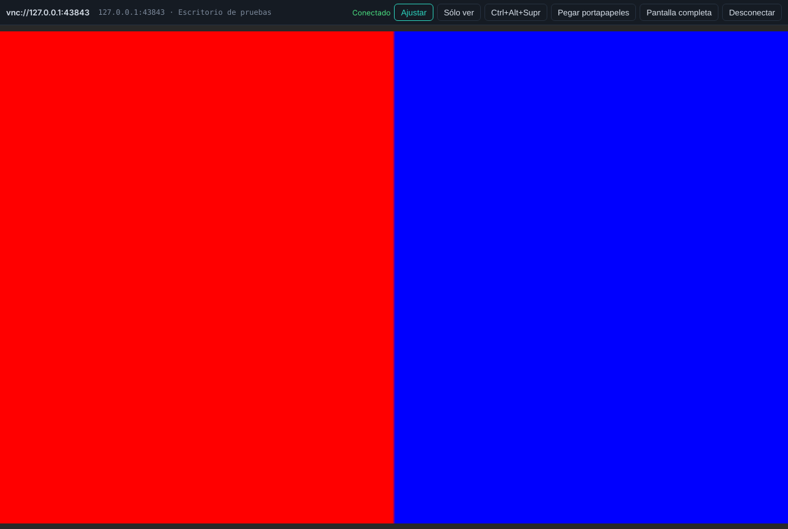

Ventana propia con escalado, modo sólo lectura, `Ctrl+Alt+Supr`, envío del portapapeles y pantalla completa.
Puede ir **por un túnel SSH** de una sesión guardada (útil cuando el VNC sólo escucha en `127.0.0.1`). La
contraseña se puede guardar en la bóveda.

## 11. Vista dividida, multi-ejecución y macros

**Vista dividida** (`Ctrl+Mayús+D`): una, dos (columnas o filas) o cuatro pestañas visibles a la vez. Haz clic
en un panel para enfocarlo.

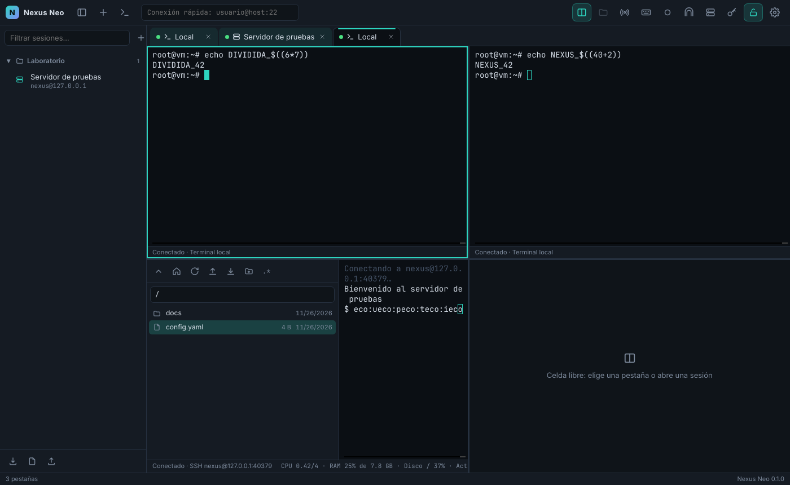

**Multi-ejecución** (`Ctrl+Mayús+M`): marca la casilla de las pestañas que quieras y lo que escribas en una se
envía a todas. La barra de estado lo indica en naranja para que no se te olvide desactivarla.

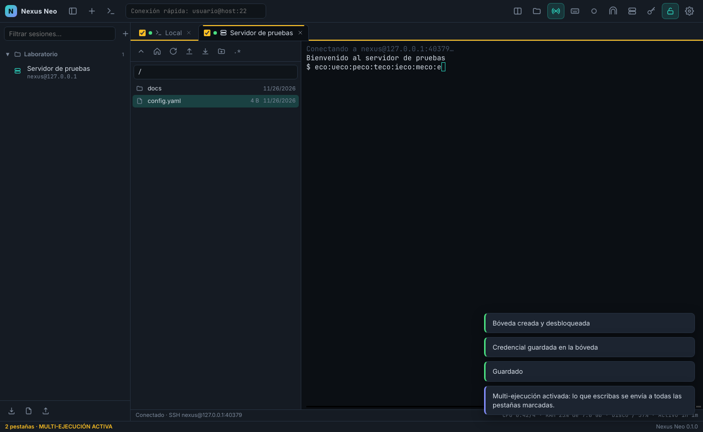

**Macros**: secuencias de texto que se envían con un clic.

- Escapes: `\n` (Intro), `\t` (tabulador), `\e` (Escape), `\xHH` (byte en hexadecimal).
- Pausas: `{sleep:500}` espera 500 ms.
- **Grabar**: pulsa el botón de grabar, escribe en el terminal y vuelve a pulsarlo; se crea una macro con lo
  tecleado.
- Se ejecutan en la pestaña activa o en todas las de multi-ejecución, y una sesión puede lanzar una macro al
  conectar.

## 12. Bóveda de credenciales

La bóveda guarda contraseñas y frases de paso cifradas con tu **contraseña maestra** (scrypt + AES-256-GCM).

- Créala con el botón del candado. Al abrir la aplicación se pide la contraseña maestra para desbloquearla.
- Se bloquea a mano o tras un tiempo de inactividad (Ajustes → Seguridad).
- Puedes cambiar la contraseña maestra en Ajustes.
- Si olvidas la contraseña maestra **no hay forma de recuperar** lo guardado: tendrás que borrar `vault.json`
  y volver a introducir las contraseñas.

## 13. Claves SSH

Botón de la llave en la barra superior:

- **Generar** claves ed25519, RSA o ECDSA, con frase de paso opcional.
- **Listar** las claves de `~/.ssh` con su huella SHA256.
- **Instalar** la clave pública en el `authorized_keys` del servidor de la pestaña activa con un clic.
- **Importar** una clave descargada (Oracle Cloud, AWS…): se copia a `~/.ssh`, se genera la `.pub` y se
  protege el archivo.
- **Corregir permisos**: en Windows ajusta la ACL para que sólo tu usuario lea la clave (evita el error
  «UNPROTECTED PRIVATE KEY FILE» de OpenSSH); en Linux aplica `chmod 600`.

## 14. Servidores integrados: TFTP, FTP, SFTP/SCP, HTTP, HTTPS, Syslog y DHCP

Panel lateral (`Ctrl+Mayús+E`) con siete servidores que se arrancan con un clic:

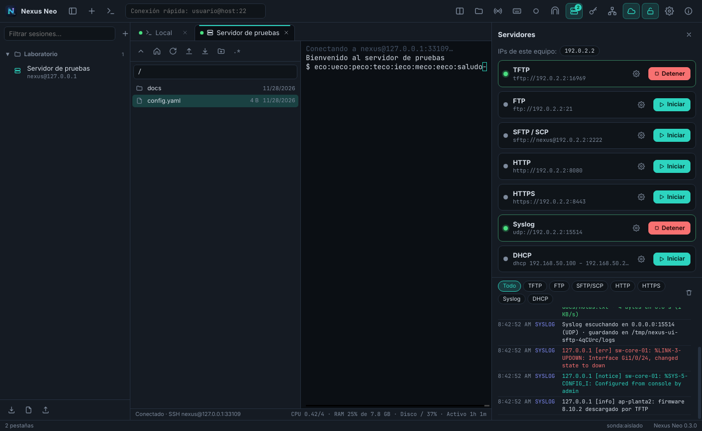

| Servidor | Puerto por defecto | Detalles |
| --- | --- | --- |
| TFTP | 69 | Subida y bajada, opciones `blksize` y `tsize`. Para firmware y configuraciones de equipos de red. |
| FTP | 21 | Pasivo y activo, usuario con contraseña o anónimo. |
| SFTP / SCP | 2222 | Servidor SSH sólo de archivos: SFTP y SCP (el moderno, que va sobre SFTP, y el clásico `scp -O`, también recursivo). Usuario con contraseña y/o claves públicas. |
| HTTP | 8080 | Listado de carpetas, descargas reanudables y subida con PUT opcional. |
| HTTPS | 8443 | Lo mismo que HTTP, cifrado con TLS. Certificado propio o autofirmado generado automáticamente. |
| Syslog | 514 | UDP y TCP, colores por severidad y un archivo por día. |
| DHCP | 67 | Reparte IP en una red de laboratorio o de aprovisionamiento, con reservas por MAC y opciones para teléfonos IP y arranque por red. |

Para cada uno eliges carpeta raíz, puerto e interfaz. El panel muestra las IP de tu equipo y un registro en vivo
de transferencias. En Linux, los puertos menores de 1024 (69, 21, 67, 80, 514) necesitan permisos; usa puertos
altos o concede `cap_net_bind_service` al ejecutable (`sudo setcap cap_net_bind_service=+ep <ruta del ejecutable>`).
Si actualizas desde una versión anterior, los servidores nuevos aparecen solos en el panel sin tocar los que ya
tenías configurados.

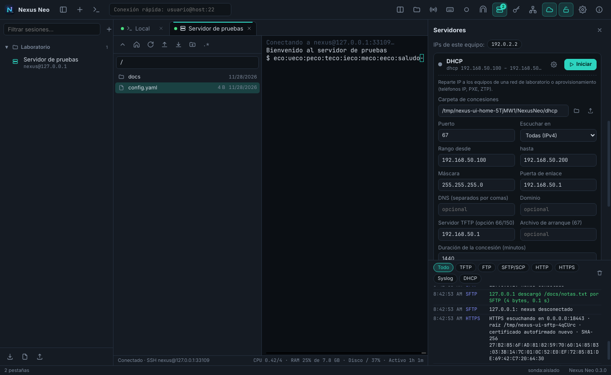

### SFTP / SCP

- Indica un **usuario** y una **contraseña** (se guarda cifrada en la bóveda) y, si quieres, **claves públicas
  autorizadas** (una por línea, formato `ssh-ed25519 AAAA… comentario`). Puedes usar sólo claves dejando la
  contraseña vacía.
- La carpeta raíz es todo lo que ve el cliente: aparece como `/` y no se puede salir de ella. No hay shell ni
  reenvío de puertos; cualquier otra orden se rechaza.
- Sin «Permitir subidas» es de sólo lectura (no se puede subir, borrar ni renombrar).
- Funciona con WinSCP, FileZilla, `sftp`, `scp` (también `scp -O` y `-r`) y con los equipos de red que copian
  por SCP, por ejemplo `copy scp://nexus@192.168.1.10/ios.bin flash:` en Cisco.
- La primera vez se genera una clave de host ed25519 propia; su huella `SHA256:…` sale en el registro al
  arrancar para que la compares con la que muestra el cliente.
- El 22 suele estar ocupado por el SSH del propio equipo, por eso el puerto por defecto es 2222.

```bash
scp -P 2222 firmware.bin nexus@192.168.1.10:/
sftp -P 2222 nexus@192.168.1.10
```

### HTTPS

- Sin certificado propio, Nexus Neo genera uno **autofirmado** (ECDSA P-256) que cubre el nombre del equipo,
  `localhost` y todas sus IP, y lo reutiliza en los siguientes arranques. Su huella SHA-256 aparece en el
  registro. El navegador avisará la primera vez porque no lo firma una autoridad; con `curl` usa `-k`, o
  `--cacert` con el archivo `https-cert.pem` de la carpeta de datos (`servidores/`).
- Para usar el tuyo, indica el certificado y la clave privada en PEM (la clave sin cifrar). Si no casan entre sí
  el servidor no arranca y te lo dice.

### DHCP

- Configura el **rango** (desde/hasta), la **máscara** y, si hace falta, la **puerta de enlace**, los **DNS**
  (separados por comas), el **dominio** y la **duración** de la concesión.
- **Servidor TFTP** y **archivo de arranque** rellenan las opciones 66, 150 (Cisco) y 67: así los teléfonos IP,
  los equipos con arranque PXE o los switches con aprovisionamiento automático (ZTP) encuentran solos su
  configuración en el servidor TFTP integrado.
- **Reservas**: una por línea, `MAC IP nombre`, para que un equipo reciba siempre la misma IP.
- Con el servidor en marcha, la tarjeta muestra la tabla de **concesiones** (IP, MAC, nombre del equipo y cuánto
  le queda). Se guardan en `concesiones-dhcp.json` dentro de la carpeta indicada y se recuerdan al reiniciar.
- Tu equipo necesita una **IP fija dentro de la misma red** que el rango, en la interfaz conectada a esos
  equipos. Si eliges una interfaz concreta en «Escuchar en», las respuestas salen por ella.
- Úsalo sólo en redes **sin otro servidor DHCP** (una red aislada, una VLAN de laboratorio o un cable directo):
  dos servidores en la misma red reparten direcciones en conflicto.
- Los equipos sólo buscan DHCP en el puerto 67. En Linux necesita el permiso `cap_net_bind_service`; en Windows,
  permite Nexus Neo en el firewall cuando te lo pregunte.

## 15. Operaciones de red

El botón **Operaciones de red** (icono de red de la barra superior) agrupa tres herramientas para switches,
routers, cortafuegos y puntos de acceso. Funcionan por **SSH o Telnet** contra muchos equipos a la vez.

### Elegir los equipos

En cada herramienta hay dos formas de indicar equipos, combinables:

1. **Sesiones guardadas** (SSH o Telnet): márcalas en la lista. Usan su usuario, clave, bastión y la
   contraseña de la bóveda.
2. **CSV**: pega o carga un archivo con una fila por equipo. Columnas reconocidas:

| Columna | Sinónimos | Significado |
| --- | --- | --- |
| `name` | `nombre`, `equipo`, `hostname` | Nombre del equipo (por defecto, el host). |
| `host` | `ip`, `direccion`, `address` | Dirección o nombre DNS. **Obligatoria.** |
| `protocol` | `protocolo` | `ssh` (por defecto) o `telnet`. |
| `port` | `puerto` | Si no es el 22/23. |
| `username` | `usuario`, `user` | Usuario propio de ese equipo. |
| `vendor` | `fabricante`, `perfil` | Perfil de fabricante (para los respaldos). |

Cualquier otra columna es una **variable** del equipo que puedes usar en órdenes y plantillas. El separador
puede ser coma o punto y coma, y las celdas pueden ir entre comillas.

```csv
name,host,protocol,vlan,ip_gestion
sw-planta1,10.0.0.11,ssh,110,10.0.10.11
sw-planta2,10.0.0.12,ssh,120,10.0.10.12
sw-antiguo,10.0.0.13,telnet,130,10.0.10.13
```

En **Credenciales y opciones de conexión** indicas el usuario y la contraseña para los equipos del CSV, la
**contraseña de enable** (si el equipo entra en modo usuario `>` se pasa a privilegiado), cuántos equipos se
atacan **a la vez** (1–50), el **tiempo máximo por orden**, una expresión de **prompt** si el equipo usa uno
raro y si se **aceptan automáticamente las huellas SSH de equipos nuevos** (las huellas que *cambian* se
preguntan siempre).

### Despliegue masivo

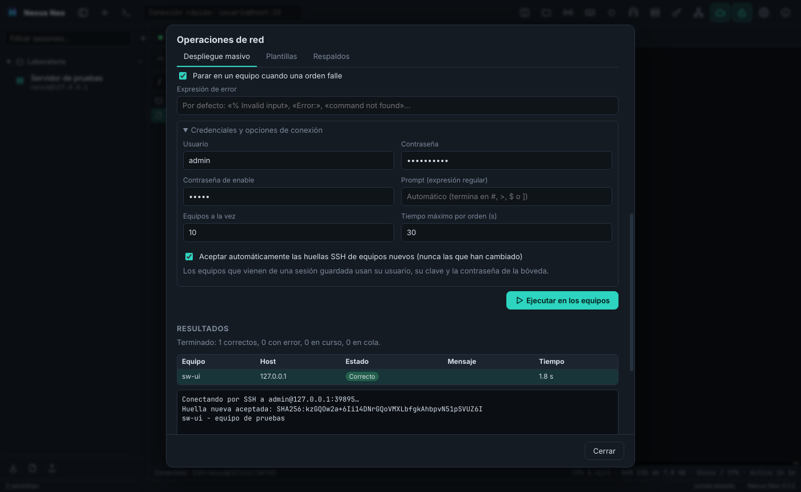

Ejecuta una lista de órdenes en todos los equipos elegidos y guarda el resultado de cada uno.

- **Una orden por línea.** Las líneas que empiezan por `#` son comentarios.
- **Variables**: `{{host}}`, `{{name}}`, `{{user}}`, `{{date}}` (AAAA-MM-DD), `{{time}}`, `{{datetime}}`,
  `{{tftp}}` (la IP de este equipo, para copiar por TFTP desde el servidor integrado), `{{file}}` (nombre del
  archivo subido) y las columnas del CSV. `{{variable | valor}}` da un valor por defecto. Si a un equipo le
  falta una variable sin valor por defecto, ese equipo falla con un mensaje claro y no se envía nada a medias.
- **Directivas**:
  - `!espera 5`: espera 5 segundos (p. ej. tras un `reload` o mientras se graba la flash).
  - `!intro`: pulsa Intro sin escribir nada (aceptar un valor por defecto).
  - `!enviar texto`: escribe texto sin esperar al prompt.
  - `!timeout 600`: cambia el tiempo máximo de las órdenes siguientes (copias de firmware largas).
- **Preguntas del equipo** (`[confirm]`, `(y/n)`, `Destination filename [x]?`): la línea siguiente es la
  respuesta. Usa `!intro` para aceptar lo que propone.
- **Paginadores** (`--More--`) se saltan solos.
- **Errores**: se marca como fallida una orden cuya salida coincide con «% Invalid input», «% Incomplete
  command», «Error:», «command not found», etc. Puedes poner tu propia expresión regular. Con **Parar en un
  equipo cuando una orden falle**, ese equipo deja de ejecutar órdenes; los demás siguen.
- **Subir un archivo antes** (firmware, configuración): elige el archivo, el destino (`flash:`, `bootflash:`,
  `/tmp/`… o una ruta completa; admite variables) y el método **SCP** (el más compatible con switches y
  routers: Cisco con `ip scp server enable`, Aruba, HPE, Juniper…) o **SFTP**. La subida necesita SSH; para
  equipos por Telnet usa el servidor TFTP integrado y `{{tftp}}`.

Ejemplo: añadir una VLAN de gestión y guardar.

```text
configure terminal
vlan {{vlan}}
 name gestion
interface Vlan{{vlan}}
 ip address {{ip_gestion}} 255.255.255.0
end
write memory
```

Ejemplo: actualizar firmware de un Cisco con subida previa por SCP.

```text
!timeout 900
show flash: | include {{file}}
configure terminal
boot system flash:{{file}}
end
write memory
```

**Resultados**: una tabla con el estado de cada equipo (en cola, en curso, correcto, error, cancelado), el
mensaje y el tiempo. Haz clic en una fila para ver su salida completa en vivo. **Cancelar los pendientes**
detiene los que aún no han empezado. **Abrir carpeta de resultados** muestra la carpeta del trabajo, con:

- `<equipo>.log`: todo lo enviado y recibido de cada equipo.
- `resumen.csv` (se abre con Excel) y `resumen.json`: estado, duración y mensaje de cada equipo.

Los resultados se guardan en la carpeta de datos, en `deploy/<fecha>_<nombre>/`.

### Plantillas de configuración

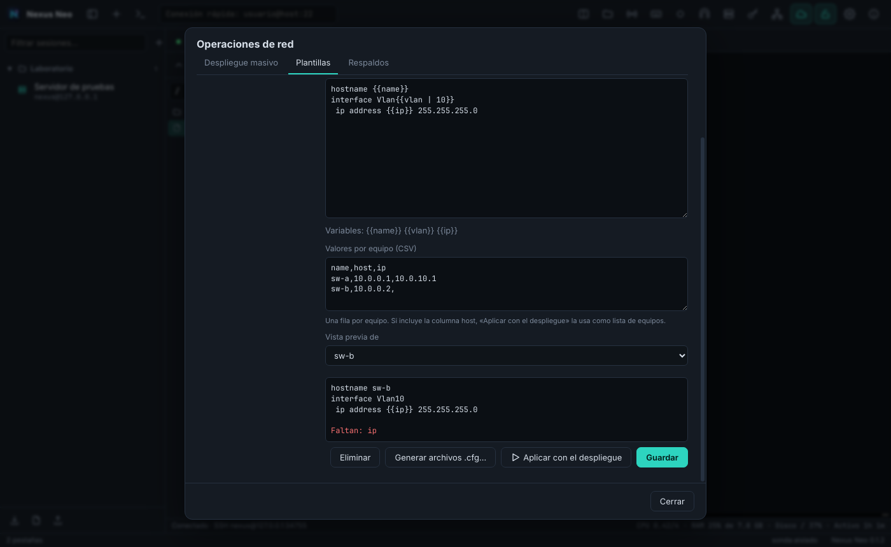

Una plantilla es un texto con variables `{{…}}` que se rellena por equipo. Se guardan en Nexus Neo y se
sincronizan entre tus equipos si tienes la [sincronización](#16-sincronización-cifrada-entre-equipos) activa.

- Escribe la plantilla y, debajo, los **valores por equipo** en CSV.
- La línea **Variables** muestra las que usa la plantilla.
- **Vista previa de** muestra el resultado para cada fila; si falta un valor, lo indica en rojo.
- **Generar archivos .cfg…** crea un archivo por fila en la carpeta que elijas (por ejemplo la raíz del
  servidor TFTP, para que los equipos los descarguen).
- **Aplicar con el despliegue** carga la plantilla como órdenes en la pestaña de despliegue y, si el CSV tiene
  columna `host`, sus filas como equipos. Revisa y pulsa Ejecutar.

### Respaldos de configuración

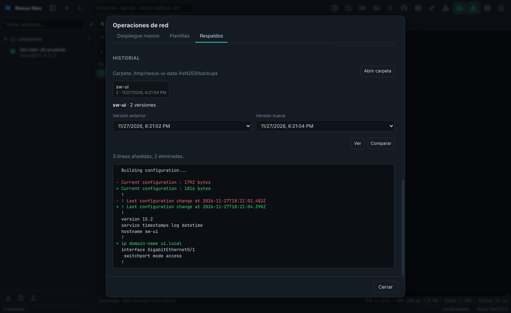

Guarda la configuración de cada equipo con fecha y te dice qué ha cambiado.

1. Marca los equipos y elige el **perfil de fabricante** de cada uno (en el CSV, columna `vendor`).
2. Pulsa **Respaldar ahora**.

Perfiles incluidos:

| Perfil | Fabricante | Orden |
| --- | --- | --- |
| `cisco-ios` | Cisco IOS / IOS-XE | `show running-config` |
| `cisco-nxos` | Cisco NX-OS | `show running-config` |
| `cisco-asa` | Cisco ASA | `show running-config` |
| `aruba-cx` | Aruba AOS-CX | `show running-config` |
| `hpe-procurve` | HPE ProCurve / Aruba AOS-S | `show running-config` |
| `hpe-comware` | HPE Comware / H3C | `display current-configuration` |
| `huawei` | Huawei VRP | `display current-configuration` |
| `juniper` | Juniper Junos | `show configuration \| display set` |
| `mikrotik` | MikroTik RouterOS | `/export terse` |
| `fortigate` | Fortinet FortiGate | `show full-configuration` |
| `paloalto` | Palo Alto PAN-OS | `show config running` |
| `dell-os10` | Dell OS10 | `show running-configuration` |
| `linux` | Linux / genérico | `cat /etc/network/interfaces` (cámbiala con «Orden propia») |

Cada perfil desactiva antes la paginación (`terminal length 0`, `no page`, `screen-length 0 temporary`…).
Con **Orden propia** sustituyes la orden de lectura para todos los equipos del trabajo.

**Sólo se guarda una versión nueva si la configuración ha cambiado.** Las líneas que cambian solas (fecha de
«Last configuration change», tamaño en bytes, marcas de tiempo de Junos o RouterOS…) no cuentan como cambio.
La tabla de resultados dice «Primer respaldo», «Cambiada» o «Sin cambios».

**Historial**: elige un equipo, dos versiones y pulsa **Comparar** para ver las líneas añadidas (verde) y
eliminadas (rojo) con su contexto, o **Ver** para leer una versión completa. Los archivos están en la carpeta de
datos, en `backups/<equipo>/<fecha>.cfg` (texto plano, puedes usarlos con cualquier herramienta).

**Respaldo programado**: en la sección «Respaldo programado», marca la casilla, indica cada cuántas horas y
pulsa **Guardar programación**. Se respaldan los equipos **marcados de la lista de sesiones guardadas** con el
perfil elegido. Si las sesiones no tienen la contraseña en la bóveda, indícala ahí (se guarda en la bóveda).
Funciona mientras Nexus Neo está abierto y con la bóveda desbloqueada.

## 16. Sincronización cifrada entre equipos

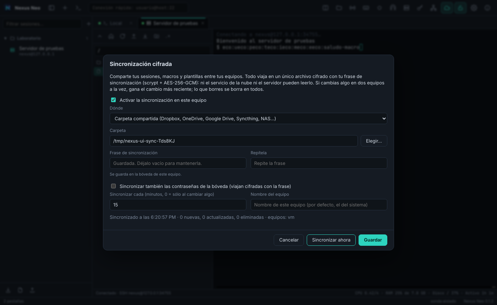

Comparte tus **sesiones, macros, plantillas de configuración y temas** entre tus ordenadores (por ejemplo, el
del trabajo y el portátil). Botón de la nube en la barra superior.

1. Marca **Activar la sincronización**.
2. Elige **dónde**:
   - **Carpeta compartida**: una carpeta de Dropbox, OneDrive, Google Drive, Syncthing, un NAS… que veas en
     todos tus equipos.
   - **Servidor SFTP**: una sesión SSH guardada y una ruta remota.
3. Escribe una **frase de sincronización** (mínimo 8 caracteres) y **usa la misma en todos tus equipos**.
4. Pulsa **Sincronizar ahora** o **Guardar**.

Detalles:

- Todo viaja en un único archivo, `nexus-neo-sync.json`, **cifrado** con tu frase (scrypt + AES-256-GCM). El
  servicio de la nube o el servidor no pueden leerlo.
- Si cambias lo mismo en dos equipos, **gana el cambio más reciente**. Lo que borras en uno se borra en todos.
- Las **contraseñas de la bóveda** sólo se sincronizan si marcas la opción (también viajan cifradas con la
  frase).
- Se sincroniza al arrancar, al desbloquear la bóveda, unos segundos después de cada cambio y cada N minutos
  (0 = sólo al cambiar algo).
- El botón de la nube se ilumina cuando está activa y se pone en naranja si el último intento falló; pasa el
  ratón por encima para ver el motivo.
- Si olvidas la frase, no se puede descifrar el archivo: borra `nexus-neo-sync.json` del destino y configura
  una frase nueva en todos los equipos.

## 17. Temas

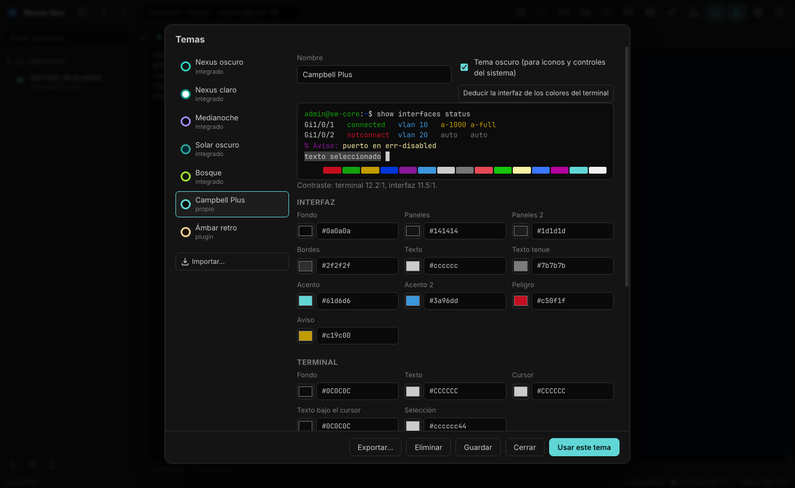

Elige el tema en **Ajustes → Apariencia** o en la paleta (`Tema: …`). Hay cinco integrados: Nexus oscuro,
Nexus claro, Medianoche, Solar oscuro y Bosque.

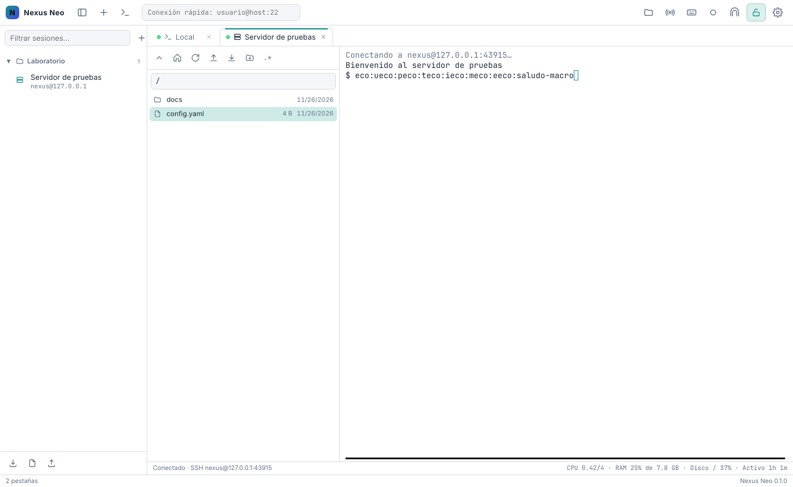

**Personalizar temas…** (en Ajustes, o «Temas» en la paleta) abre el editor:

- Elige cualquier tema de la lista y cambia sus colores: los de la **interfaz** (fondo, paneles, bordes, texto,
  acentos, peligro y aviso) y los del **terminal** (fondo, texto, cursor, selección y los 16 colores ANSI).
  Cada cambio se ve al instante en la ventana y en la vista previa.
- El editor avisa si el **contraste** del texto es bajo (menos de 4.5:1).
- **Deducir la interfaz de los colores del terminal** calcula colores de interfaz que combinan con el esquema.
- Al **guardar** un tema integrado o de un plugin se crea una copia propia; los temas propios se pueden
  modificar, **exportar** a JSON y **eliminar**.
- **Importar…** admite:
  - temas exportados de Nexus Neo;
  - esquemas de color de **Windows Terminal** (uno, una lista o el `settings.json` entero: se importan todos los
    de `schemes`);
  - archivos `.itermcolors` de **iTerm2**.
  Pega el contenido o elige el archivo. Los colores de la interfaz se deducen del esquema.
- **Usar este tema** lo aplica y lo selecciona en Ajustes.

Los temas propios se sincronizan entre tus equipos si tienes la sincronización activa.

## 18. Plugins

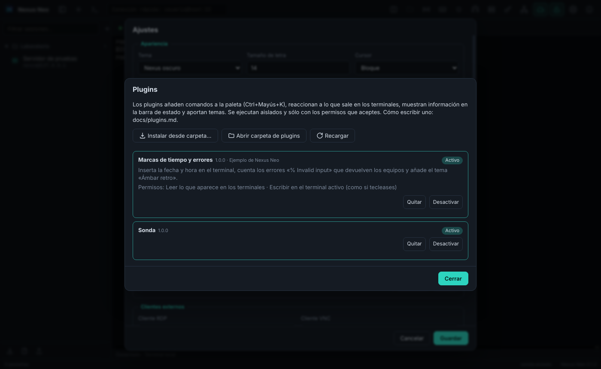

Los plugins amplían Nexus Neo con comandos de la paleta, reacciones a lo que aparece en los terminales,
información en la barra de estado y temas. Ábrelos en **Ajustes → Plugins…** o en la paleta («Plugins…»).

- **Instalar desde carpeta…**: elige la carpeta del plugin (la que contiene `manifest.json`). También puedes
  copiarla a mano en la carpeta de plugins (**Abrir carpeta de plugins**) y pulsar **Recargar**.
- **Activar**: se muestra quién lo hizo y **qué permisos pide**. Los plugins son código de terceros: actívalos
  sólo si confías en su origen.
- **Desactivar** lo detiene al momento; **Quitar** lo borra junto con sus datos.
- Si un plugin se actualiza y pide permisos nuevos, queda en «Pide permisos nuevos» y no se ejecuta hasta que
  los revises.
- Los errores del plugin aparecen en rojo en su ficha.

**Aislamiento**: cada plugin se ejecuta en su propio *Web Worker*, sin acceso a Node.js, a tus archivos, a la
red, a la bóveda ni a la página. Sólo puede usar la API de Nexus Neo y, para lo sensible, con permiso:

| Permiso | Qué permite |
| --- | --- |
| `terminal:read` | Leer lo que aparece en los terminales. |
| `terminal:write` | Escribir en el terminal activo, como si tecleases. |
| `sessions:read` | Ver la lista de sesiones (nombre, tipo, host y carpeta; nunca contraseñas). |

Sin permisos, un plugin puede añadir comandos a la paleta, mostrar avisos y preguntas, escribir en la barra de
estado, aportar temas y guardar sus propios datos.

En el repositorio hay un plugin de ejemplo, `examples/plugins/marcas-de-tiempo`, que inserta la fecha y hora,
cuenta los errores «% Invalid input» de los equipos y añade el tema «Ámbar retro». Para escribir el tuyo,
consulta [plugins.md](plugins.md).

## 19. Ajustes y registro de sesiones

**Apariencia**: tema, tipografía, tamaño de letra (también `Ctrl` `+`/`-`/`0`), estilo y parpadeo del cursor,
temas y plugins.

**Terminal**: líneas de historial, shell local por defecto, copiar al seleccionar, pegar con clic derecho,
confirmar al cerrar pestañas remotas y reconexión automática.

**Registro de sesiones**: guarda la salida de **todas** las sesiones en archivos (o activa sólo las que
quieras con «Guardar registro de esta sesión en archivo» en el editor de la sesión). Se crea una carpeta por día; puedes quitar los códigos de color y
elegir la carpeta.

**Clientes externos**: cliente RDP (vacío = visor integrado) y VNC si prefieres los del sistema.

**Seguridad**: bloqueo automático de la bóveda y cambio de contraseña maestra.

## 20. Atajos de teclado

| Atajo | Acción |
| --- | --- |
| `Ctrl+Mayús+T` | Nueva terminal local |
| `Ctrl+Mayús+W` | Cerrar pestaña |
| `Ctrl+Tab` / `Ctrl+Mayús+Tab` | Pestaña siguiente / anterior |
| `Ctrl+Mayús+K` | Paleta de comandos |
| `Ctrl+Mayús+E` | Panel de servidores (TFTP, FTP, HTTP, Syslog) |
| `Ctrl+Mayús+D` | Cambiar la vista dividida |
| `Ctrl+Mayús+M` | Activar/desactivar multi-ejecución |
| `Ctrl+Mayús+S` | Mostrar/ocultar SFTP |
| `Ctrl+Mayús+B` | Mostrar/ocultar el panel de sesiones |
| `Ctrl+Mayús+F` | Buscar en el terminal |
| `Ctrl+Mayús+C` / `Ctrl+Mayús+V` | Copiar / pegar |
| `Ctrl` `+` / `-` / `0` | Zoom del texto |
| `R` (pestaña desconectada) | Reconectar |
| `F2` / `Supr` (panel de sesiones) | Editar / eliminar la sesión |

## 21. Dónde se guardan los datos y modo portable

| Sistema | Carpeta de datos |
| --- | --- |
| Windows | `%APPDATA%\Nexus Neo\data` |
| Linux | `~/.config/Nexus Neo/data` |

La ruta exacta aparece al pie de **Ajustes**. Contenido:

| Archivo o carpeta | Qué guarda |
| --- | --- |
| `sessions.json`, `macros.json`, `templates.json`, `themes.json` | Sesiones, macros, plantillas y temas propios. |
| `settings.json` | Ajustes. |
| `vault.json` | Bóveda cifrada. |
| `known_hosts.json` | Huellas SSH y de certificados RDP aceptadas. |
| `deleted.json` | Borrados pendientes de sincronizar. |
| `deploy/` | Resultados de los despliegues. |
| `backups/` | Respaldos de configuración. |
| `plugins/`, `plugin-data/` | Plugins instalados y sus datos. |
| `logs/` | Registros de sesiones (por defecto). |

**Modo portable**: crea un archivo vacío llamado `portable` junto al ejecutable y los datos se guardarán en
`data/` a su lado. Así puedes llevar Nexus Neo en un USB.

**Copia de seguridad**: basta con copiar la carpeta de datos. Para pasar sesiones a otro equipo sin la bóveda
usa Exportar, o mejor la sincronización cifrada.

## 22. Seguridad

- La interfaz se ejecuta aislada (`contextIsolation`, `sandbox`, sin `nodeIntegration`) y con una política de
  contenido estricta.
- Las contraseñas sólo se escriben en disco **cifradas** en la bóveda, nunca en `sessions.json` ni en las
  exportaciones.
- Las huellas de servidores SSH y de certificados RDP se verifican siempre; un cambio se avisa como posible
  ataque.
- En los trabajos masivos, la aceptación automática de huellas sólo afecta a equipos **nuevos**; una huella
  cambiada siempre se pregunta.
- El archivo de sincronización va cifrado con tu frase y autenticado (se detecta cualquier manipulación).
- Los plugins se ejecutan aislados y sólo con los permisos que aceptas.
- Usa Nexus Neo sólo con equipos y redes para los que tengas autorización.

## 23. Solución de problemas

**«UNPROTECTED PRIVATE KEY FILE» o «bad permissions» con una clave.** Abre Claves SSH y pulsa «Corregir» en
esa clave, o impórtala a `~/.ssh` desde el mismo diálogo.

**La conexión SSH avisa de que la clave del host ha cambiado.** Si has reinstalado el servidor o cambiado su
IP, es normal: acepta la nueva clave. Si no sabes por qué ha cambiado, no conectes y consúltalo con quien
administre el servidor.

**Mosh se queda en «Sin respuesta…» al empezar.** El SSH ha funcionado pero el UDP no llega: abre los puertos
UDP 60000–61000 (o el rango configurado) en el cortafuegos del servidor y de la red, o indica en la sesión un
rango que sí esté abierto. Comprueba también que `mosh-server` está instalado.

**RDP falla con un error de credenciales.** Revisa usuario y dominio (`DOMINIO\usuario` o el campo Dominio).
Si el equipo exige NLA, el usuario debe tener permiso de escritorio remoto. Para servidores que sólo admiten
RDP antiguo sin TLS, usa el cliente del sistema.

**En el despliegue un equipo da «No se ha reconocido el prompt».** El equipo usa un prompt poco habitual:
indica una expresión regular en «Prompt», por ejemplo `[\w.-]+[#>] ?$`.

**«Tiempo de espera agotado» en una orden larga** (copiar firmware, `write memory` lento). Sube el tiempo
máximo por orden o añade `!timeout 900` antes de esa orden.

**El respaldo dice que el equipo no reconoce la orden.** El perfil de fabricante no es el correcto: cámbialo
o usa «Orden propia».

**La subida por SCP falla en un Cisco.** Activa el servidor SCP en el equipo (`ip scp server enable`) y
asegúrate de que el usuario tiene privilegio 15. Como alternativa usa el servidor TFTP integrado con
`copy tftp://{{tftp}}/archivo flash:`.

**Los servidores TFTP/FTP/HTTP/Syslog no arrancan en Linux.** Los puertos por debajo de 1024 necesitan
privilegios: usa un puerto alto o concede `cap_net_bind_service`.

**La sincronización da «frase incorrecta».** Todos los equipos deben usar la misma frase. Si la has perdido,
borra `nexus-neo-sync.json` del destino y vuelve a configurarla en todos.

**Un plugin no hace nada.** Ábrelo en Ajustes → Plugins: si hay un error aparece en rojo. Comprueba que pide en
`manifest.json` los permisos que usa.
